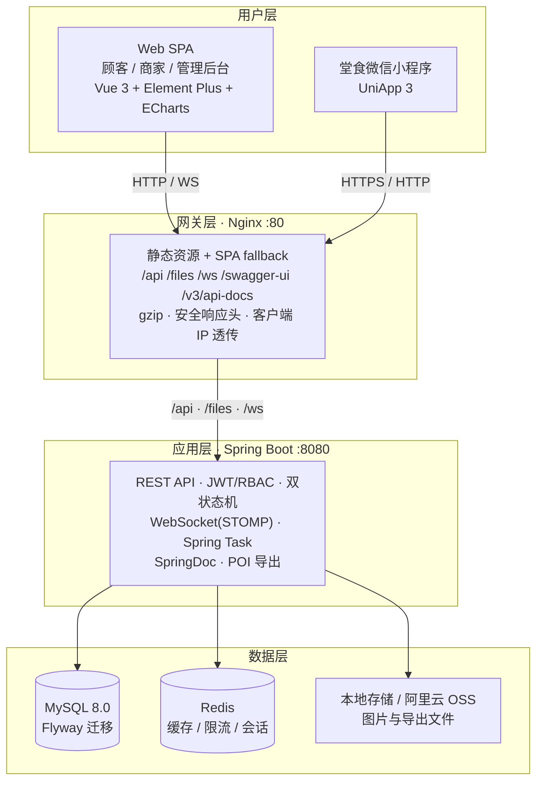

# 餐厅点餐系统 MVP

外卖 Web（顾客 / 商家 / 管理后台）+ 堂食微信小程序（UniApp）+ Spring Boot 3 后端 + MySQL / Redis / Nginx 四层架构。

> **当前状态（2026-10-28，T52 文档收口）**：核心业务与技术链路已实现，具备可运行的本机开发链路；隔离环境真后端冒烟 A–E 通过。Docker 运行态、真实 OSS / 微信、小程序真机扫码等仍未验证，详见第 10 节。
>
> 本仓库为演示用 MVP：**严禁 TypeScript**；支付为模拟扣款 0.01 元，不接入真实资金链路。

---

## 1. 项目概览

| 端 | 形态 | 技术 | 入口 |
|---|---|---|---|
| 顾客 / 商家 / 管理后台 | 响应式 Web SPA | Vue 3.5 + Vite + Element Plus + ECharts + STOMP | Nginx `http://127.0.0.1/`（本机 dev：`http://127.0.0.1:5173`） |
| 堂食顾客 | 微信小程序 / H5 | UniApp 3 + Vue 3 | 微信开发者工具；H5 `http://127.0.0.1:5174` |
| 后端 | REST + WebSocket + 定时任务 | Spring Boot 3.5.16（Java 17）、Spring Security + JWT、MyBatis-Plus、Flyway、SpringDoc | `http://127.0.0.1:8080` |
| 网关 | 静态托管 + 反向代理 | Nginx 1.27（Docker）/ 1.30（本机） | 80 |
| 数据 | 关系库 + 缓存 | MySQL 8.0、Redis 7（容器）/ 8.x（本机） | 3306 / 6379 |

核心能力：

- **外卖**：菜单浏览、购物车、幂等下单、模拟支付 + HMAC 回调、商家接单/制作/配送/完成、顾客评价、订单超时自动取消。
- **堂食**：桌台二维码 HMAC 签名、扫码建会话、`X-Table-Session` 下单支付、商家出餐、完成后桌台自动释放。
- **平台**：商家审核/菜品/分类、订单与报表、优惠券、审计日志、xlsx 导出、ECharts 报表、WebSocket 实时订单、Swagger、OSS 直传（本地存储兜底）。
- **交付质量**：双状态机、参数校验、统一错误码、跨域、限流、生产密钥 fail-fast、日志 traceId。

---

## 2. 架构



- Nginx 是唯一入口；`/api`、`/files`、`/ws` 反代后端，其余走静态文件与 SPA fallback。
- 上传：local 模式由后端接收 multipart 并写入 `storage/`；oss 模式优先浏览器 Post Policy 直传，也支持服务端 `putObject`（如桌台二维码）。
- 实时：STOMP over WebSocket（`/ws`），CONNECT 强制 JWT，订阅按目的地做 ACL。
- 详细设计见 [docs/01-architecture.md](docs/01-architecture.md)、[docs/adr/](docs/adr/)。

---

## 3. 目录结构

```text
restaurant-mvp/
├── backend/                 # Spring Boot 3（Maven；Java 17）
│   ├── src/main/java/       # controller / service / mapper / state machine / security ...
│   ├── src/main/resources/  # application*.yml、db/migration（Flyway）
│   └── src/test/            # 单元 + 集成测试
├── web/                     # Vue 3 SPA（Vite；JavaScript）
│   ├── src/                 # views / components / api / stores / router
│   └── tests/               # Vitest
├── miniprogram/             # UniApp 3 堂食小程序（JavaScript）
├── e2e/                     # Playwright E2E（mock + 真后端可复用）
├── deploy/
│   ├── nginx/               # nginx.conf（Docker）、nginx.local.conf（本机）
│   ├── backend/Dockerfile
│   └── web/Dockerfile
├── scripts/                 # dev-local / smoke-test / export-openapi / check-*
├── docs/                    # 01–06 设计、测试、部署文档 + ADR + openapi.json
├── docker-compose.yml       # mysql / redis / backend / web / nginx
├── .env.example             # 环境变量样例（复制为 .env）
└── package.json             # 根脚本入口（不引入运行时依赖）
```

文档索引：

| 文档 | 内容 |
|---|---|
| [docs/00-requirements.md](docs/00-requirements.md) | 需求、范围与验收标准 |
| [docs/01-architecture.md](docs/01-architecture.md) | 架构、模块、数据模型、部署拓扑 |
| [docs/02-api.md](docs/02-api.md) | REST / WebSocket 契约、错误码、状态机 |
| [docs/03-data-model.md](docs/03-data-model.md) | 表结构、种子账号、数据字典 |
| [docs/04-testing.md](docs/04-testing.md) | 测试策略、用例与执行记录 |
| [docs/05-security.md](docs/05-security.md) | 安全审查、修复状态与残余风险 |
| [docs/06-deployment.md](docs/06-deployment.md) | 部署、环境变量、Nginx、验收与未验证清单 |
| [docs/openapi.json](docs/openapi.json) | 由运行中后端导出的 OpenAPI 3.1 文档（T74 快照：T72 `68064f1`，97 paths / 121 operations） |

---

## 4. 功能地图

| 模块 | 顾客 | 商家 | 管理员 |
|---|---|---|---|
| 账号 | 注册 / 登录 / 资料 | 登录（审核通过后） | 登录 |
| 菜品 | 分类、列表、详情、评价 | 分类 / 菜品 CRUD、上下架、库存 | — |
| 外卖订单 | 购物车、优惠试算、下单、支付、取消、确认收货、评价 | 接单、制作、配送、完成、拒单 | 查看 / 导出 |
| 堂食 | 扫码 / 手输桌号、会话内点餐、支付、加菜 | 桌台、堂食订单制作/出餐/完成 | — |
| 平台 | — | 营业额/订单报表 | 商家审核、用户、订单、优惠券、审计、统计、导出 |
| 实时 | 订单状态推送 | 新订单/桌台事件 | 平台事件 |

完整接口与字段以 [docs/02-api.md](docs/02-api.md) 为准；禁止前端自造路径或字段。

---

## 5. 快速开始（本机开发）

### 5.1 前置条件

| 依赖 | 版本 / 说明 |
|---|---|
| JDK | 21（后端编译目标 Java 17） |
| Maven | 3.9+ |
| Node.js | ≥ 20.19（小程序要求 ≥ 22.12） |
| pnpm | 12.x（`corepack enable`） |
| MySQL | 8.0，`127.0.0.1:3306`，需先建库 `restaurant_mvp`（测试库 `restaurant_mvp_test`） |
| Redis | 7/8，`127.0.0.1:6379` |
| Nginx | 可选；本机路径见 `docs/06-deployment.md` §2 |
| Docker | 可选；本机当前未安装，Compose 运行态未验证 |

### 5.2 配置

```powershell
# 仓库根目录
Copy-Item .env.example .env
# 按本机 MySQL/Redis 修改 DB_* / REDIS_*；演示密钥仅限本地，生产必须替换
```

`.env` 不会提交（`.gitignore` 已忽略）。后端在 `local`/`dev` profile 下使用其中的开发默认值；生产必须设置强密钥并切到 `docker`/`prod` profile，否则启动 fail-fast。

建库（若尚未创建，二选一）：

```sql
CREATE DATABASE IF NOT EXISTS restaurant_mvp
  DEFAULT CHARACTER SET utf8mb4 COLLATE utf8mb4_unicode_ci;
```

```powershell
mysql -h127.0.0.1 -uroot -p -e "CREATE DATABASE IF NOT EXISTS restaurant_mvp DEFAULT CHARACTER SET utf8mb4 COLLATE utf8mb4_unicode_ci;"
```

Flyway 会在后端首次启动时自动执行 `V1__schema.sql`、`V2__seed_data.sql` 迁移并写入演示种子数据。

### 5.3 安装依赖

```powershell
# 后端依赖由 Maven 解析；前端与小程序分别安装
cd web;  pnpm install; cd ..
cd miniprogram; pnpm install; cd ..
cd e2e;  pnpm install; npx playwright install chromium; cd ..
```

### 5.4 一键启动

```powershell
# 后端 :8080 + Web dev :5173（读取 .env；日志在 .runtime/logs/）
npm run dev

# 额外启动本机 Nginx :80（需先 cd web; pnpm build）
npm run dev:nginx

# 停止脚本启动的进程（含子进程树与 Nginx）
npm run dev:stop
```

启动后：

| 用途 | 地址 |
|---|---|
| Web（Vite dev） | <http://127.0.0.1:5173> |
| 后端 API | <http://127.0.0.1:8080/api/v1> |
| Swagger UI（local profile） | <http://127.0.0.1:8080/swagger-ui/index.html> |
| OpenAPI JSON | <http://127.0.0.1:8080/v3/api-docs> |
| 健康检查 | <http://127.0.0.1:8080/actuator/health> |
| Nginx 入口（`-WithNginx`） | <http://127.0.0.1/> |

> 登录限流为 5 次/分钟/IP；连续跑冒烟脚本时请间隔约 1 分钟。

### 5.5 前端生产构建 + 本机 Nginx

```powershell
cd web
pnpm build                 # 产物：web/dist
cd ..
npm run dev:nginx          # 启动后端 + Nginx（80）
# 或手动：scripts/dev-local.ps1 -WithNginx
```

### 5.6 堂食小程序

微信开发者工具导入 `miniprogram/`（需在 `miniprogram/manifest.json` 配置自己的 AppID；本项目无真实 AppID）。

```powershell
cd miniprogram

# H5 预览（默认 5174；mock 模式无需后端）
pnpm dev:h5
pnpm dev:h5:mock

# 微信小程序构建（产物 dist/dev/mp-weixin）
pnpm dev:mp-weixin
pnpm dev:mp-weixin:mock        # 无真实凭证时的演示模式

# 生产构建
pnpm build:h5
pnpm build:mp-weixin
```

`WECHAT_MOCK=true` 时后端允许 mock 登录；真实微信登录需配置 `WECHAT_APP_ID` / `WECHAT_APP_SECRET`（勿提交仓库）。

---

## 6. 环境变量

`.env.example` 是唯一权威样例（Compose 自动读取根目录 `.env`；`scripts/dev-local.ps1` 优先读取 `.env`，缺省回退 `.env.example`）。

### 6.1 通用 / 数据库 / Redis

| 变量 | 默认（示例） | 说明 |
|---|---|---|
| `TZ` | `Asia/Shanghai` | 时区 |
| `SPRING_PROFILES_ACTIVE` | `dev` | `local`/`dev`/`test` 使用开发默认；生产必须 `docker` 或 `prod` |
| `LOG_LEVEL` | `INFO` | 应用日志级别 |
| `MYSQL_ROOT_PASSWORD` | `root123456` | Compose MySQL root 密码；**生产必须替换** |
| `MYSQL_DATABASE` | `restaurant_mvp` | Compose 初始化库名 |
| `MYSQL_HOST_PORT` | `13306` | MySQL 宿主端口（避让本机 3306） |
| `DB_HOST` | `127.0.0.1` | 本机后端连接地址；Compose 内强制 `mysql` |
| `DB_PORT` | `3306` | MySQL 端口 |
| `DB_NAME` | `restaurant_mvp` | 库名 |
| `DB_USERNAME` | `root` | 数据库用户 |
| `DB_PASSWORD` | `123456` | 数据库密码；Compose 下取 `MYSQL_ROOT_PASSWORD` |
| `REDIS_HOST_PORT` | `16379` | Redis 宿主端口（避让本机 6379） |
| `REDIS_HOST` | `127.0.0.1` | 本机后端连接地址；Compose 内强制 `redis` |
| `REDIS_PORT` | `6379` | Redis 端口 |
| `REDIS_PASSWORD` | 空 | Redis 密码（可选） |
| `REDIS_DATABASE` | `0` | Redis DB 编号 |

### 6.2 鉴权 / 桌台 / 支付

| 变量 | 默认（示例） | 说明 |
|---|---|---|
| `JWT_SECRET` | 开发占位值 | HS256 签名密钥，**≥ 32 字节**；生产必须替换 |
| `JWT_EXPIRES_IN_SECONDS` | `7200` | access token 有效期（秒） |
| `TABLE_QR_SECRET` | 开发占位值 | 桌台二维码 HMAC 密钥；生产必须替换 |
| `TABLE_QR_BASE_URL` | `http://127.0.0.1/t` | 二维码内容基址（`?p=<tableId>&s=<sig>`） |
| `PAYMENT_MOCK_CHARGE_AMOUNT` | `0.01` | 模拟支付实际扣款额（元） |
| `PAYMENT_MOCK_CALLBACK_BASE_URL` | `http://127.0.0.1:8080` | 模拟回调基址（`app.payment.mock-callback-base-url`；Compose 覆盖为 `http://backend:8080`） |
| `PAYMENT_CALLBACK_SECRET` | 开发占位值 | 支付回调 HMAC-SHA256 密钥；生产必须替换 |
| `ORDER_PAYMENT_TIMEOUT_MINUTES` | `15` | 未支付订单超时取消（Spring Task） |
| `TABLE_SESSION_IDLE_MINUTES` | `120` | 桌台会话空闲清理 |
| `CORS_ALLOWED_ORIGINS` | `http://localhost,...` | 允许跨域来源，逗号分隔 |

### 6.3 限流与受信代理

| 变量 | 默认（示例） | 说明 |
|---|---|---|
| `RATE_LIMIT_LOGIN` | `5` | 登录：按客户端 IP 每分钟次数 |
| `RATE_LIMIT_REGISTER` | `5` | 顾客注册：按客户端 IP 每分钟次数，与登录独立计数 |
| `RATE_LIMIT_WECHAT` | `5` | 微信登录 `code2session` 换 token：按客户端 IP 每分钟次数，与登录独立计数 |
| `RATE_LIMIT_ORDER` | `10` | 创建订单：按用户每分钟次数 |
| `RATE_LIMIT_PAYMENT` | `10` | 支付/模拟支付：按用户每分钟次数 |
| `RATE_LIMIT_API` | `120` | 其余已认证接口：按用户 + 方法 + 路径每分钟次数 |
| `RATE_LIMIT_TRUSTED_PROXIES` | `127.0.0.1,::1,10.0.0.0/8,172.16.0.0/12,192.168.0.0/16,fc00::/7` | 受信反向代理（精确 IP 或 CIDR，逗号分隔）；仅直连地址命中该列表时，才采信 `X-Real-IP` / `X-Forwarded-For`。留空表示不信任任何代理 |

- 客户端 IP 解析顺序（T65）：仅当 `remoteAddr` 在 `RATE_LIMIT_TRUSTED_PROXIES` 内时，优先取严格合法的 `X-Real-IP`；否则取 `X-Forwarded-For` **最右侧未受信跳**；否则回退 `remoteAddr`。客户端伪造的 XFF 左侧值不会成为限流 key。
- Nginx（T66）在 `http` 层用 `$remote_addr` **覆盖** `X-Real-IP` / `X-Forwarded-For`，不追加客户端自带值；后端 8080 若直连暴露，未受信来源仍只能使用 `remoteAddr`。
- 生产若在 Nginx 前再加 SLB/CDN，必须把前置代理地址加入 `RATE_LIMIT_TRUSTED_PROXIES`，并在 Nginx `real_ip` 模块配置可信源；否则 `$remote_addr` 是前置代理地址，所有用户会共享限流额度。
- **Compose 注意**：当前 `docker-compose.yml` 的 `backend.environment` 未显式透传上述 `RATE_LIMIT_*` 变量，容器内使用默认值；需要调优时请在 Compose 的 `backend.environment` 增加同名变量（宿主 `.env` 不会自动注入未声明的容器变量）。

### 6.4 存储 / 微信 / 端口

| 变量 | 默认（示例） | 说明 |
|---|---|---|
| `STORAGE_TYPE` | `local` | `local` 或 `oss`；`oss` 缺项启动即失败（不静默降级） |
| `STORAGE_LOCAL_DIR` | `./storage` | 本地文件目录（Compose 覆盖为 `/app/storage`） |
| `STORAGE_LOCAL_URL_PREFIX` | `/files` | 本地文件访问前缀 |
| `STORAGE_MAX_SIZE_MB` | `5` | 单文件上限 |
| `OSS_ENDPOINT` | 空 | OSS Endpoint（`oss` 必填） |
| `OSS_BUCKET` | 空 | Bucket（`oss` 必填） |
| `OSS_ACCESS_KEY_ID` | 空 | AK ID（仅服务端/Policy 使用；**禁止提交真实值**） |
| `OSS_ACCESS_KEY_SECRET` | 空 | AK Secret（**永不返回前端/日志**） |
| `OSS_PUBLIC_BASE_URL` | 空 | 公网访问前缀（带 `https://`） |
| `OSS_DIR` | `restaurant/` | 仅 Post Policy 直传的目录前缀 |
| `OSS_POST_EXPIRE_SECONDS` | `300` | 仅 Post Policy 有效期 |
| `WECHAT_MOCK` | `true` | 无微信凭证时使用 mock 登录 |
| `WECHAT_APP_ID` | 空 | 微信小程序 AppID |
| `WECHAT_APP_SECRET` | 空 | 微信 AppSecret（**禁止提交**） |
| `JAVA_OPTS` | `-Xms256m -Xmx512m` | JVM 参数 |
| `BACKEND_HOST_PORT` | `8080` | Compose 后端宿主端口 |
| `WEB_HOST_PORT` | `80` | Compose Nginx 宿主端口 |

生产必需替换项：`JWT_SECRET`、`PAYMENT_CALLBACK_SECRET`、`TABLE_QR_SECRET`、`DB_PASSWORD` / `MYSQL_ROOT_PASSWORD`；`STORAGE_TYPE=oss` 时还需五项 `OSS_*`。详见 [docs/06-deployment.md](docs/06-deployment.md) §4。

---

## 7. Docker Compose（可选）

```powershell
Copy-Item .env.example .env       # 修改密钥/端口
docker compose config -q          # 静态展开校验
docker compose up -d --build
docker compose ps
docker compose logs -f backend
docker compose down               # 保留数据卷；docker compose down -v 清空
```

- 服务：`mysql:8.0`、`redis:7-alpine`、`backend`、`web`（一次性构建产物发布）、`nginx:1.27-alpine`。
- 宿主端口默认：MySQL `13306`、Redis `16379`、后端 `8080`、Nginx `80`，避免与本机既有服务冲突。
- Docker / 生产 profile 下 Swagger 默认关闭，`/swagger-ui` 返回 404 属预期。
- **本机无 Docker**：Compose 仅通过 `node scripts/check-compose.mjs` 做静态校验，运行态「未验证」。

---

## 8. 测试与质量门禁

### 8.1 后端

```powershell
cd backend
mvn -DskipTests package                 # 构建
mvn test                                # 单元 + 集成（需要 MySQL/Redis）
```

隔离测试库 `restaurant_mvp_test`，`application-test.yml` 使用独立 profile 与确定性密钥。当前基线：**137 个测试通过 / 0 失败**（T50，2026-10-28；命令与 SKIP 项见 [docs/04-testing.md](docs/04-testing.md)）。

### 8.2 Web

```powershell
cd web
pnpm test                               # Vitest，39 个用例
pnpm build                              # Vite 生产构建
```

### 8.3 E2E

```powershell
cd e2e
npx playwright test                     # 44 个用例；默认 mock 驱动
npx playwright test --list              # 列出用例
```

真后端模式所需环境变量与开关见 `e2e/README.md` / [docs/04-testing.md](docs/04-testing.md)。T49 证据：44 用例中 17 个在真实后端链路通过（其余依赖 mock/受限端点），详见 docs/04。

### 8.4 冒烟（REST 全链路）

```powershell
# 后端直连（默认 127.0.0.1:8080）
npm run smoke

# 经 Nginx 网关
npm run smoke:gateway

# 显式指定隔离后端；密钥只从环境变量读取，脚本不硬编码
$env:PAY_CALLBACK_SECRET = '<与后端一致>'
$env:TABLE_QR_SECRET = '<与后端一致>'
powershell -NoProfile -ExecutionPolicy Bypass -File scripts/smoke-test.ps1 `
  -BaseUrl http://127.0.0.1:18085 -SkipSlow -SkipGateway
```

覆盖 A 基础 / B 外卖 / C 堂食 / D 文件 / E 导出 / F 慢测（默认 SKIP）/ G 网关（可选）。T55 证据：**59 PASS / 0 FAIL / 5 SKIP，exit=0**（隔离后端 18085）。SKIP 项与参数见 [docs/06-deployment.md](docs/06-deployment.md) §8.1。

### 8.5 静态门禁

```powershell
npm run check:all        # no-ts + no-secrets + compose
```

| 命令 | 检查 | 通过标准 |
|---|---|---|
| `npm run check:no-ts` | 禁止 TypeScript 的源码/配置/依赖残留 | 0 违规 |
| `npm run check:no-secrets` | 硬编码凭证（AK/Secret/私钥/JWT/DB 密码字面量等） | 0 违规 |
| `npm run check:compose` | Compose 与两套 Nginx 配置静态契约（13 项） | 13 项 PASS（Docker 缺失时 SKIP 并标「未验证」） |

### 8.6 OpenAPI

```powershell
npm run openapi:export
# 生成 docs/openapi.json（UTF-8 无 BOM，需后端 /v3/api-docs 就绪）
```

当前快照：OpenAPI `3.1.0`，**97 个 path / 121 个 operation / 15 个 tag**，由 T72 HEAD `68064f1` 的 local profile 真实导出（941,316 bytes，UTF-8 无 BOM；`nativePath` 与 `/ws/native` 均为 0）。与 `docs/02-api.md` 的 115 个端点逐条比对 **115/115 覆盖**，另有 6 个实现侧端点（文件上传/下载、xlsx 导出、堂食接单）不在契约端点表。重新导出后请与 `docs/02-api.md` 对照；工作区未提交的契约改动不包含在快照中。

---

## 9. 验收演示路径

前置：后端 8080 + Web 5173 已启动；种子账号如下（仅演示，生产必须替换/删除）：

| 角色 | 账号 | 密码 |
|---|---|---|
| 顾客 | `customer` | `customer123` |
| 商家 | `merchant` | `merchant123` |
| 管理员 | `admin` | `admin123` |

### 9.1 外卖

1. 顾客登录 → 选购菜品 → 购物车 → 下单（两次相同 `Idempotency-Key` 应返回同一 `orderId`）。
2. 创建支付：页面显示真实应付金额，`mockHint` 含「¥0.01」；模拟回调后订单变为 `PAID`。
3. 商家登录 → 接单 → 制作 → 配送 → 完成；顾客确认收货并评价。
4. 商家端/管理端「订单」页与 ECharts 报表应反映新订单；导出 xlsx 能下载。

### 9.2 堂食

1. 商家端桌台页展示 A01 二维码（`p`、`s`）；小程序扫码或手动输入桌号。
2. 建立会话后带 `X-Table-Session` 下单、支付；商家接单 → 制作 → 出餐 → 完成。
3. 完成后桌台应回到 `FREE`，原会话失效。

### 9.3 图片与导出

- 菜品图片上传后可从 `/files/...` 访问；`GET /api/v1/files/policy` 不应包含 `accessKeySecret`。
- 商家/管理员订单导出返回 `application/vnd.openxmlformats-officedocument.spreadsheetml.sheet` 且首字节为 `PK`。

### 9.4 实时与网关

- 商家端保持在线，新订单通过 WebSocket 实时出现。
- 经 `http://127.0.0.1/` 访问 `/healthz`、`/api/v1/public/config`、Swagger（local profile）、刷新任意前端路由（SPA fallback）。

---

## 10. 未验证事项与已知风险

以下项目**不得**根据本地静态检查或部分链路推断为通过：

- `docker compose up` 全栈、镜像构建、容器 healthcheck、Nginx 容器运行态与卷发布（本机无 Docker）。
- 真实阿里云 OSS 上传/下载、微信 `code2session`、小程序真机扫码与微信开发者工具真机预览。
- 真实 HTTPS/TLS、HSTS 启用、CSP（M-04 为已接受的 XSS/token 存储风险，见 [docs/05-security.md](docs/05-security.md)）。
- 支付超时慢测（F 组）与全部 Nginx 网关组合（G 组）未在每次冒烟中执行；SKIP 不等于通过。
- E2E 中依赖真实后端的部分用例、跨浏览器矩阵、性能/并发压测。
- 小程序 iOS/Android 真机差异、弱网与离线场景。

已知残余风险与修复状态以 [docs/05-security.md](docs/05-security.md) 为准；部署相关未验证清单见 [docs/06-deployment.md](docs/06-deployment.md) §12。

---

## 11. 常见问题

| 现象 | 处理 |
|---|---|
| 后端启动失败 / health 不 UP | 看 `.runtime/logs/backend.log`；确认 MySQL/Redis 可连、`.env` 密码正确、Flyway 无报错 |
| `Access denied for user 'root'` | `.env` 的 `DB_PASSWORD` 与本机 MySQL 不一致（当前示例 `123456`） |
| 端口被占用 | `Get-NetTCPConnection -LocalPort 8080 -State Listen`；`npm run dev:stop` 或结束对应进程 |
| 登录 429 | 登录限流 5 次/分钟/IP，等待约 1 分钟 |
| 上传 400/40003 | 检查扩展名/MIME/大小（PNG/JPG/JPEG/WEBP，≤5MB） |
| Swagger 404（Docker） | docker/生产 profile 默认关闭，属预期；local 或临时 `SPRINGDOC_*_ENABLED=true` 开启 |
| `docker: command not found` | 本机未安装 Docker，改用本机部署；Compose 静态校验仍可运行 |
| PowerShell 中文乱码 | 用 Windows PowerShell 5.1 运行；脚本以 UTF-8 BOM 保存 |
| Nginx `CreateDirectory() failed (3)` | 先创建 `.runtime/nginx/temp/*`，见 docs/06 §7.2 |

更多排障与完整命令见 [docs/06-deployment.md](docs/06-deployment.md) §10。

---

## 12. 协作约定

- **禁止 TypeScript**：前端/小程序/E2E 全部 JavaScript；`npm run check:no-ts` 兜底。
- 不提交 `.env`、`node_modules/`、`target/`、`web/dist/`、`.runtime/`、真实凭证/OSS AK/微信 Secret。
- 接口以 [docs/02-api.md](docs/02-api.md) 冻结契约为准；跨端改动同步契约与测试。
- 文档与实现同步：新增端点/环境变量/部署步骤时更新 docs/06 与 README。
- 提交信息带上任务号（如 `[T52]`）；每个任务附可复现验证命令与真实输出。
